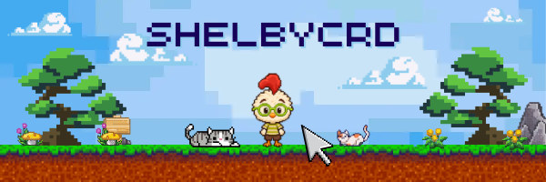
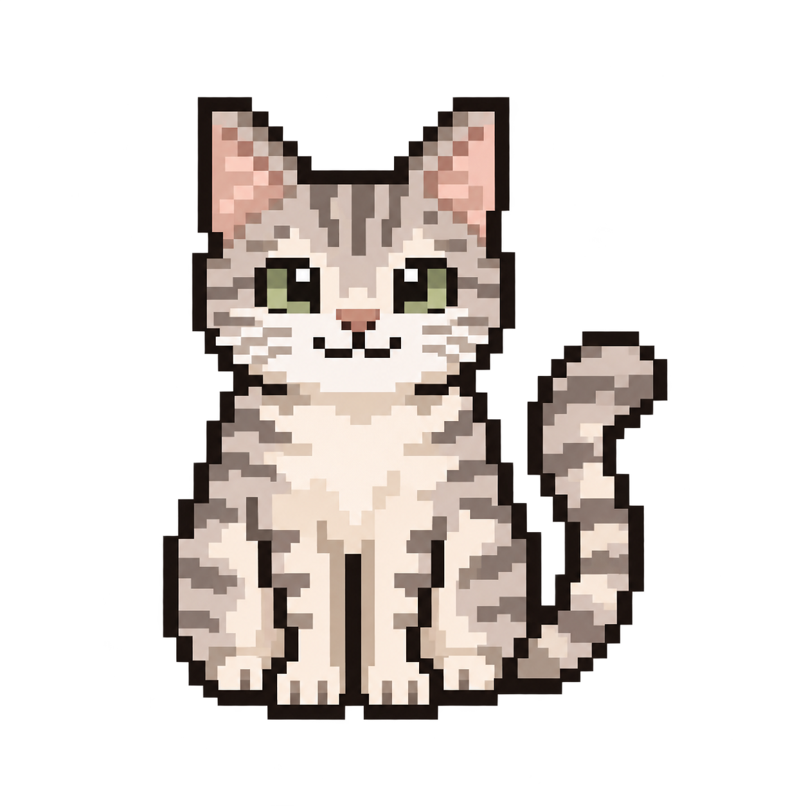

### `Hello!!`

**Computer Science Student | Website Developer | Builder**

## `🎮 ABOUT ME`

**Hello, World! I'm Angelo.**

A Computer Science student who loves creating things. I enjoy turning my ideas to projects
and challenging myself with new stuffs. :>

- Studying **Computer Science** at a university
- Building **Web applications and software**
- Interested in **Modding and Minecraft**
- Im currently exploring **full-stack development**

 

<h2 align="center">FEATURED PROJECTS</h2>

<table>
  <tr>
    <td align="center" width="33%">
      <h3>Queezo</h3>
      
A study platform with flashcards, GWA calculator, and Pomodoro timer.

      
<b>Python · FastAPI · SQLite</b>

      
    </td>
    <td align="center" width="33%">
      <h3>Northpoint</h3>
      
A collaborative software engineering management and tracking system.

      
<b>JavaScript · FastAPI · Docker</b>

      
    </td>
    <td align="center" width="33%">
      <h3>UltraBloodMoon</h3>
      
A Minecraft plugin featuring dangerous Blood Moon events and challenges.

      
<b>Java · Plugins</b>

      
    </td>
  </tr>
</table>

 

